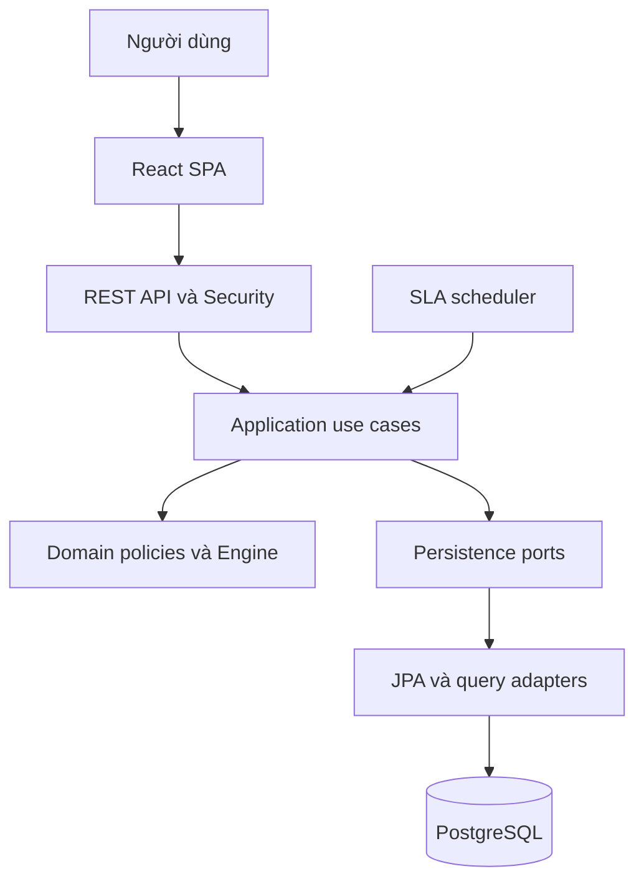
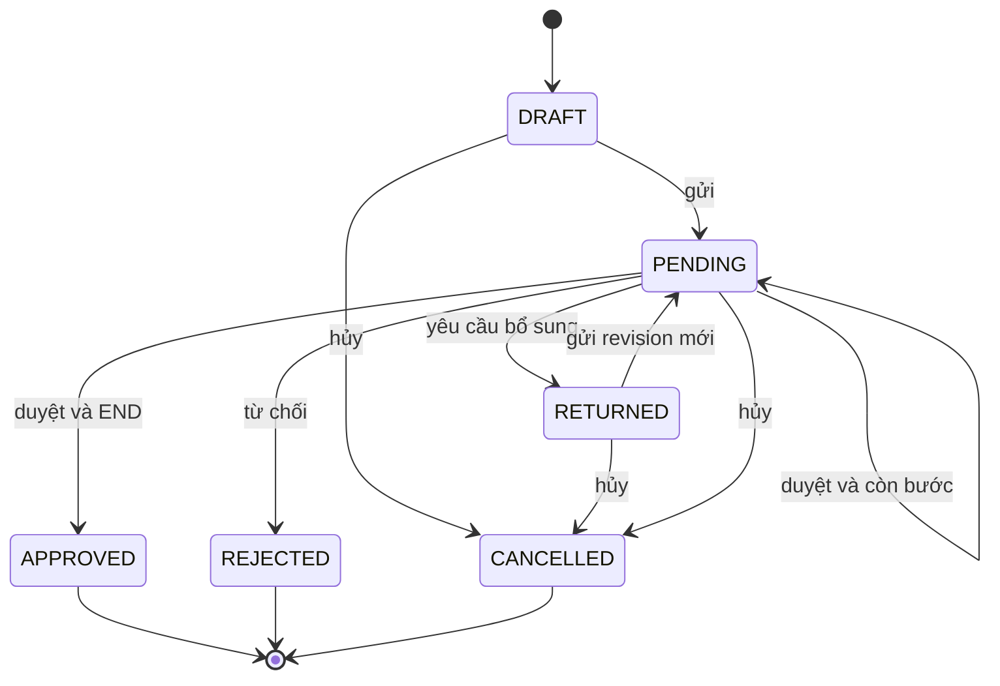

# FlowOps — Tài liệu thiết kế và phát triển cho team

**Mã tài liệu:** FLO-DEV-001  
**Phiên bản:** 1.0 DRAFT · **Ngày:** 07/11/2026  
**Đối tượng:** Leader, Backend, Frontend, QA và người triển khai.  
**Mục đích:** thống nhất cách xây source MVP từ nghiệp vụ đến cấu trúc code, dữ liệu, API, giao dịch và kiểm thử. Tài liệu mô tả kiến trúc mục tiêu; chưa khẳng định đã có source hoặc đã đạt chỉ tiêu tải.

**Nguồn và thứ tự ưu tiên:**
1. SRS FlowOps 2.0, bản `(2).docx`, dự thảo 02/11/2026: nguồn yêu cầu.
2. `FlowOps_CSDL_SRS20.md` và `FlowOps_DB_SRS20.dbml`: thiết kế dữ liệu 21 bảng ngày 04/11/2026.
3. Tài liệu này: cụ thể hóa HOW và hợp đồng làm việc giữa các thành viên.
4. SAD cũ 1.0 chỉ được tái sử dụng phần còn phù hợp; các phần 5 role, upload file, gửi lại luôn cùng bước và mã OD cũ đã bị thay thế.

**Cách đọc:** đọc a–c để hiểu sản phẩm; d–g để thiết kế; h để code use case; i–k để tạo repo, tích hợp và kiểm thử; l để xử lý quyết định còn mở. Dùng một thuật ngữ và một trạng thái thống nhất giữa DB, API, BE và FE.

Bố cục a–h lấy cách tổ chức từ mẫu phát triển SGOD công ty cung cấp. Stack và quy mô SGOD không được áp sang FlowOps: PostgreSQL là nguồn sự thật duy nhất; audit, timeline và thông báo in-app ghi cùng giao dịch nghiệp vụ. Không dùng audit best-effort cho các chuyển trạng thái đã xác nhận.

---

## a. Tổng quan dự án

### Bài toán nghiệp vụ

Một tổ chức cần xử lý mua sắm thiết bị, hoàn chi phí và cấp quyền truy cập. Hồ sơ đi qua các cấp duyệt khác nhau theo dữ liệu nhập, ví dụ mua sắm từ 10 triệu đồng phải qua Tài chính. Quy trình thay đổi theo tổ chức nên hệ thống cần cho cấu hình biểu mẫu, bước và điều kiện thay vì code ba luồng riêng.

FlowOps quản lý vòng đời: cấu hình → xuất bản → tạo nháp → gửi → nhận task → quyết định/chuyển bước → bổ sung hoặc kết thúc. Hồ sơ đang chạy giữ nguyên version quy trình; các lần gửi có revision riêng để chứng minh ai đã duyệt nội dung nào.

### Mục tiêu và quy mô tham chiếu

| Mục tiêu | Bằng chứng dự kiến |
|---|---|
| Một engine dùng chung | Ba workflow chạy bằng dữ liệu cấu hình, không switch theo mã workflow |
| Đúng người đúng dữ liệu | Chặn tự duyệt; quyết định gắn revision đang xem |
| Không duyệt trùng | 100 quyết định cạnh tranh hợp lệ trên một task: một thắng |
| Dễ vận hành | Có dashboard, timeline, audit và hàng đợi cần phân công/lỗi điều phối |
| Hiệu năng theo SRS | 50 người đồng thời; 10.000 hồ sơ; 50.000 task; trang 20 mục; p95 API danh sách <500 ms; 30 phút ổn định sau 5 phút làm nóng |

Đây là mục tiêu kiểm chứng, không phải số liệu đo. Cấu hình máy tham chiếu vẫn thuộc DEC03 của SRS. Không nhận thêm các mục tiêu 100 VU/250.000 task từ SAD cũ như yêu cầu đã được duyệt.

### Ba vai trò và ba khu giao diện

| Role | Khu giao diện | Quyền chính |
|---|---|---|
| ROLE_EMPLOYEE | Hồ sơ của tôi | Nháp, gửi, bổ sung, hủy, xem revision/timeline của mình |
| ROLE_APPROVER | Hộp thư duyệt | Task cá nhân/nhóm, claim, quyết định task được giao |
| ROLE_ADMIN | Quản trị | Tài khoản/tổ chức, nhóm duyệt, cấu hình/publish, điều phối, audit/dashboard |

Một tài khoản mang nhiều role. Admin muốn tạo hồ sơ phải có thêm Employee; muốn duyệt phải có thêm Approver và task giao đúng người. Cấm tự duyệt ưu tiên trên mọi role. Trưởng bộ phận là chức danh; Finance/Accounting/IT là nhóm duyệt, không phải role bổ sung.

### Phạm vi MVP

**Có:** 3 workflow mẫu, biểu mẫu động, điều kiện AND/OR, quy trình tuần tự rẽ nhánh, revision, task nhóm/cá nhân, SLA, phân công lại, URL chứng từ, thông báo in-app, timeline, audit và dashboard.

**Ngoài phạm vi:** upload/lưu tệp vật lý; email/SMS/push ngoài ứng dụng; thanh toán; ký số; tự cấp quyền IT; multi-tenant; BPMN đầy đủ; nhánh song song; loop và code tùy ý. Không thêm organization_id giả định từ mẫu SGOD vào các bảng của MVP một tổ chức.

### Stack triển khai đề xuất

| Lớp | Lựa chọn cho source | Ghi chú |
|---|---|---|
| Frontend | React + TypeScript + Vite | Một SPA, các route theo role |
| UI và form | Tailwind CSS, React Hook Form, Zod | Validation FE hỗ trợ UX; BE vẫn kiểm lại |
| Dữ liệu FE | TanStack Query | Query key theo user, bộ lọc, request/revision |
| Backend | Java 21, Spring Boot 3.x, Spring Security | Chốt patch version khi khởi tạo repo và khóa dependency |
| Persistence | Spring Data JPA/Hibernate, PostgreSQL 16 | Không dùng Prisma trong backend Java |
| Schema | Flyway | Không dùng auto-update schema trong môi trường chia sẻ |
| Auth | JWT access token gắn sid + user_sessions | Thu hồi từng phiên và auth_version toàn tài khoản |
| Test | JUnit, Testcontainers, Playwright, công cụ load test | Chạy test với PostgreSQL thật |
| Triển khai | Docker Compose, reverse proxy HTTPS | PostgreSQL volume và backup; không file volume nghiệp vụ |

Các lựa chọn công nghệ là ADR của bản thiết kế này, không phải điều kiện bất biến của SRS. Không thêm Redis/Kafka/Elasticsearch/MinIO vào MVP khi chưa có nhu cầu được duyệt.

---

## b. Kiến trúc dự án

### Modular Monolith và Ports and Adapters ở mức vừa đủ

Một backend process và một PostgreSQL. Mỗi feature tách application, domain/policy, infrastructure và API. Domain tập trung rule, không gọi HTTP hoặc repository JPA. Application service sở hữu transaction và phối hợp qua port. Không tạo CQRS bus/event broker chỉ để giống mẫu.

**Phụ thuộc:** API → application → domain/ports; infrastructure triển khai ports. Spring cấu hình và wiring ở bootstrap. DTO API không trả thẳng JPA entity. Reporting được đọc nhiều bảng qua query adapter có kiểm quyền; không ghi trạng thái.



### Luồng xử lý một lệnh

1. Controller parse DTO và xác thực phiên.
2. Authorization policy xác định quyền hiện tại; application mở transaction, khóa/check lại các dữ liệu quyết định quyền và state.
3. Kiểm idempotency, version và revision mà người dùng đã xem.
4. Domain/policy thực thi rule; engine chọn bước và người nhận bằng cấu hình.
5. Persistence ghi state/task/revision, timeline, audit và notification trong cùng transaction.
6. Commit rồi trả DTO; frontend invalidate query liên quan. Exception giữa chừng rollback toàn bộ thay đổi chưa được xác nhận.

### Ranh giới module và ownership

| Module SRS | Package triển khai | Dữ liệu sở hữu | Port chính |
|---|---|---|---|
| M1 — tài khoản/tổ chức | identity, organization | users, roles, user_roles, groups/members, departments, sessions | CurrentPrincipal, OrganizationDirectory, AuthorizationPolicy |
| M2 — cấu hình | workflowconfig | definitions, versions, steps, transitions | PublishedWorkflowReader, WorkflowPublisher |
| M3 — hồ sơ | requests | requests, request_edits, request_revisions | RequestReader, RequestWriter, RevisionService |
| M4 — điều phối/duyệt | approvals, workflowruntime | tasks, revision_approvals, incidents | TaskWriter, WorkflowEngine, AssignmentResolver |
| M5 — toàn vẹn/giám sát | operations, notifications, audit, reporting | receipts, events, audit_logs, notifications | CommandDeduplicator, TimelineWriter, AuditWriter, NotificationWriter |

SRS 2.0 gom thành 5 module; các package con không phải role hoặc module nghiệp vụ mới. Engine điều phối Request/Task qua port, không tự lấy repository nội bộ của module khác. Các port ghi tham gia transaction của caller, không tự tạo transaction riêng tùy tiện.

### Tính nguyên tử của lịch sử và thông báo

Domain result có thể tạo danh sách sự kiện nội bộ trong bộ nhớ; application ghi chúng trước commit. Không sử dụng `@Async` hoặc listener sau commit để ghi bản audit bắt buộc. Lỗi ghi audit/notification trong một chuyển trạng thái phải rollback kết quả đó. Đọc/đánh dấu thông báo là giao dịch riêng và không ảnh hưởng quyết định đã commit.

### Quyền và dữ liệu nguồn

Source manager/department được chốt ở lần gửi đầu. Tính active/Approver và thành viên nhóm được kiểm tra hiện tại. Hai khái niệm không được trộn: đổi quản lý hiện tại không tự định tuyến lại hồ sơ cũ; người quản lý nguồn bị khóa thì cần điều phối theo thẩm quyền đã xác nhận.

---

## c. Các chức năng và màn hình

| Feature | Màn hình và chức năng | Đầu ra cần có | FR |
|---|---|---|---|
| Auth | Login, đổi mật khẩu, logout, thông báo lỗi | Phiên hợp lệ, thông tin roles, thu hồi phiên | 01 |
| Tổ chức | User list/editor, departments, quản lý nguồn, groups/members | Dữ liệu tổ chức hợp lệ; không mất Admin cuối | 02–03 |
| Workflow builder | Danh mục, draft version, form fields, step list, branch editor, validate/publish | DAG hợp lệ, version bất biến | 04–07 |
| Hồ sơ nhân viên | Workflow khả dụng, form động, nháp, danh sách, chi tiết | Gửi lần đầu, mã và revision | 08–10 |
| Bổ sung/hủy | Working copy, so sánh thay đổi, xác nhận hủy | Revision mới; restart/continue rõ ràng | 11–12 |
| Inbox | Tab cá nhân/nhóm, claim, chi tiết revision, ba quyết định | Một người nhận, một quyết định/task | 13–14 |
| Điều phối Admin | Task thiếu người, reassign, routing incidents | Người mới hợp lệ; hạn giữ nguyên | 15 |
| Hạn và thông báo | DueAt, cờ quá hạn, trung tâm thông báo | Nhắc đúng người, đọc/chưa đọc, không trùng | 16, 18–19 |
| Giám sát | Timeline, audit query, dashboard/drill-down | Số đúng, dữ liệu trong quyền | 20–21 |
| Toàn vẹn | Không có màn hình riêng | Retry an toàn; xung đột rõ ràng | 17 |

### Quy tắc UI

- Backend trả `allowedActions` để hỗ trợ hiển thị nút; policy backend vẫn là nguồn quyết định quyền.
- Form từ version đã pin. Sau gửi, màn hình đọc revision, không bind trực tiếp vào working copy.
- Khi RETURNED, hiển thị lý do, revision gốc, phần đang sửa và thay đổi dự kiến. Backend quyết restart; frontend chỉ giải thích.
- Task chưa claim có nút Nhận việc; task đã giao cho người khác không có nút quyết định.
- NEEDS_ASSIGNMENT có cảnh báo và luồng Admin; không xuất hiện như một task Admin có thể duyệt.
- 409: giữ phần nhập có thể giữ, tải lại state, yêu cầu xác nhận lại; không tự retry quyết định bằng payload cũ.
- Logout/đổi tài khoản phải xóa Query cache và thông tin nhạy cảm; không để cache người A hiện cho B.
- Quyền đọc sau khi đã quyết định còn TBD07; UI phải xử lý mất quyền, không cho rằng notification/timeline cũ là vé truy cập.

---

## d. Thiết kế cơ sở dữ liệu

### Nguồn sự thật và sơ đồ

Dùng `FlowOps_CSDL_SRS20.md` làm data dictionary và `FlowOps_DB_SRS20.dbml` làm nguồn sơ đồ. Hai file được đóng cùng gói tài liệu. Có 21 bảng; không lấy schema 13 bảng trong SAD cũ để triển khai.

| Nhóm | Bảng |
|---|---|
| Identity/organization — 7 | departments, users, roles, user_roles, approval_groups, approval_group_members, user_sessions |
| Workflow config — 4 | workflow_definitions, workflow_versions, workflow_steps, workflow_transitions |
| Runtime — 6 | requests, request_revisions, request_edits, tasks, revision_approvals, request_events |
| Operations — 4 | audit_logs, notifications, workflow_incidents, command_receipts |

### Điểm dữ liệu phải triển khai đúng

1. `requests.request_code` NULL ở nháp; cấp khi gửi thành công; sequence được phép có khoảng trống.
2. `first_submitted_at` bất biến, dùng dashboard; `last_submitted_at` thay đổi sau resubmit.
3. `request_edits` là working copy; `request_revisions` là dữ liệu đã gửi không sửa/xóa.
4. `tasks.revision_id` luôn chỉ đúng nội dung task đã xét; không đổi sang revision mới khi bổ sung.
5. `revision_approvals` ghi mỗi bước đã được duyệt có hiệu lực trên revision đích; nếu kế thừa phải giữ source_task_id gốc.
6. `workflow_transitions.target_type=END_APPROVED` có to_step_id=NULL; STEP bắt buộc có to_step_id thuộc cùng version.
7. Snapshot nguồn tổ chức giữ tại requests; active/quyền/nhóm hiện tại vẫn kiểm khi claim/quyết định.
8. Thiếu người vẫn tạo task PENDING/NEEDS_ASSIGNMENT để Admin có đối tượng phân công; due_at bắt đầu từ created_at, kể cả lúc chưa có người.
9. Lỗi routing giữ hồ sơ PENDING với incident ROUTING_ERROR; không APPROVED do không khớp nhánh.
10. FK giữa task/revision/request/step/version phải kiểm cùng hồ sơ/version, không chỉ ID có tồn tại.

### Index và bất biến

Partial unique: một DRAFT/một PUBLISHED mỗi workflow; một task PENDING mỗi request; một default mỗi bước; một incident OPEN mỗi request/loại. Unique notifications: event/user/type; riêng TASK_OVERDUE unique task/user. Unique command receipt: actor/command/clientKey. Email unique lower(email).

Guard bảo vệ cả version, steps và transitions sau publish; guard append-only cho revision, approval links, timeline và audit. Cần migration PostgreSQL cho partial index, CHECK, triggers và FK vòng; export SQL từ DBML chưa có đầy đủ các guard này.

### Thứ tự migration đề xuất

| Tệp | Nội dung |
|---|---|
| V1__identity_organization.sql | Tạo 7 bảng; FK departments.manager_id thêm sau users |
| V2__workflow_configuration.sql | 4 bảng; thêm FK start_step sau steps |
| V3__request_runtime.sql | requests trước revisions; sau đó current_revision FK, edits/tasks/approval links/events |
| V4__operations.sql | audit, notifications, incidents, receipts |
| V5__constraints_indexes.sql | CHECK, composite FK bổ sung và partial indexes |
| V6__immutable_guards.sql | Trigger bất biến/append-only và quyền tài khoản ứng dụng |
| Dev seed riêng | Ba role, tài khoản giả lập, nhóm duyệt, ba workflow mẫu |

Seed account và mật khẩu demo chỉ bật profile development; tài khoản Admin triển khai thật cấp bằng quy trình bootstrap riêng. Không đưa mật khẩu thật vào migration/Git.

---

## e. Thiết kế API và hợp đồng BE FE

### Quy ước chung

- Base path: `/api/v1`; health không trả secret. Dùng HTTPS khi triển khai.
- Xác thực: `Authorization: Bearer <accessToken>`. Access token chứa `sub`, `sid`, `authVersion`, hạn; backend kiểm session và user hiện tại.
- Browser giữ access token trong bộ nhớ; refresh secret qua cookie HttpOnly/Secure/SameSite phù hợp môi trường; request dùng cookie phải có kiểm origin/CSRF phù hợp. Không log token.
- ID BIGINT trả dưới dạng **string JSON**, tránh mất chính xác trong JavaScript. Version là integer trong miền kiểm soát; thời gian ISO-8601 UTC, FE hiển thị UTC+7.
- Phân trang MVP: `page` bắt đầu 0, `size` mặc định 20, tối đa 100; response `items,page,size,total`. Chỉ cho sort/filter theo whitelist; SQL filter quyền trước phân trang/count.
- PATCH để sửa nháp/cấu hình; POST cho command. DELETE chỉ xóa nháp hồ sơ chưa gửi hoặc nội dung nháp cấu hình chưa publish.
- Các lệnh submit, resubmit, claim, decision, cancel, reassign và recover có `Idempotency-Key` UUID bắt buộc. Lưu working copy dùng version guard; các CRUD Admin chưa bắt buộc key nhưng vẫn có kiểm unique và khóa phù hợp.
- DTO dùng camelCase; DB snake_case. POST tạo tài nguyên trả 201; lệnh nghiệp vụ trả 200 với state mới; DELETE nháp trả 204.
- Đầu vào lạ ngoài DTO hoặc key field không có trong schema bị từ chối, không dùng mass assignment.

### Các endpoint dự kiến

Tất cả đường dẫn dưới đây nằm sau `/api/v1`. Đây là hợp đồng thiết kế cần chuyển sang OpenAPI trước khi chia code; không khẳng định đã có endpoint chạy.

| Method | Path | Người dùng | Payload/kết quả chính |
|---|---|---|---|
| POST | /auth/login | Public | username/password → accessToken và cookie refresh |
| POST | /auth/refresh | Phiên hợp lệ | Refresh secret → token mới; kiểm sid/authVersion |
| POST | /auth/logout | Đã xác thực | Revoke sid hiện tại, xóa cookie |
| POST | /auth/password | Đã xác thực | currentPassword/newPassword; revoke mọi phiên |
| GET | /me | Đã xác thực | id, roles, profile, permissions |
| GET/POST | /users | Admin | Phân trang/tạo tài khoản |
| PATCH | /users/{id} | Admin | profile/roles/groupIds/active và version; giữ Admin cuối |
| GET/POST | /departments | Admin | Danh sách/tạo phòng ban |
| PATCH | /departments/{id} | Admin | code/name/parentId/managerId/active; chặn chu trình |
| GET/POST | /approval-groups | Admin | Danh sách/tạo nhóm |
| PATCH | /approval-groups/{id} | Admin | name/active/memberIds; audit và rà task ảnh hưởng |
| GET | /workflows/available | Employee | Workflow/version đang nhận mới, không lộ cấu hình nháp |
| GET/POST | /workflows | Admin | Danh mục; code duy nhất |
| PATCH | /workflows/{id} | Admin | name/description/active/version |
| POST | /workflows/{id}/versions | Admin | cloneFromVersionId tùy chọn → nháp mới |
| GET | /workflow-versions/{id} | Admin | Toàn bộ nháp/published config và lockVersion |
| PATCH | /workflow-versions/{id} | Admin | Config document + version; chỉ DRAFT |
| POST | /workflow-versions/{id}/validate | Admin | version → violations; không publish |
| POST | /workflow-versions/{id}/publish | Admin | version → PUBLISHED; archive bản cũ cùng transaction |
| POST | /workflow-versions/{id}/archive | Admin | version → ngừng nhận mới |
| DELETE | /workflow-versions/{id} | Admin | Xóa DRAFT chưa được tham chiếu |
| GET | /requests | Theo quyền | Bộ lọc status/workflow/from/to/flags; mặc định hồ sơ nhìn được |
| POST | /requests | Employee | workflowVersionId/title → nháp + working copy |
| GET | /requests/{id} | Theo quyền | state, revision, currentTask, flags, actions |
| PATCH | /requests/{id}/draft | Chủ nháp | title/formData/requestVersion/editVersion |
| POST | /requests/{id}/draft-version | Chủ nháp | targetVersionId + versions; xác nhận chuyển schema |
| DELETE | /requests/{id} | Chủ nháp | requestVersion; chỉ DRAFT chưa gửi |
| POST | /requests/{id}/submit | Chủ nháp | requestVersion/editVersion; dữ liệu lấy từ DB |
| GET | /requests/{id}/revisions | Theo quyền | Các bản đã gửi và provenance |
| GET | /requests/{id}/revisions/{revisionId} | Theo quyền | Snapshot + effectiveApprovals |
| GET | /requests/{id}/edit | Chủ khi RETURNED | Working copy và baseRevisionId |
| PATCH | /requests/{id}/edit | Chủ khi RETURNED | formData/requestVersion/editVersion |
| POST | /requests/{id}/resubmit | Chủ khi RETURNED | requestVersion/editVersion/baseRevisionId |
| POST | /requests/{id}/cancel | Chủ hồ sơ | requestVersion/reason |
| GET | /requests/{id}/timeline | Theo quyền | Events phân trang; revision liên quan |
| GET | /tasks | Approver | scope=mine hoặc group, status/due; loại trừ tự duyệt |
| GET | /tasks/{id} | Theo quyền | Task + requestVersion + revision + actions |
| POST | /tasks/{id}/claim | Ứng viên hợp lệ | taskVersion/requestVersion/revisionId |
| POST | /tasks/{id}/decisions | Assignee hợp lệ | action/reason/taskVersion/requestVersion/revisionId |
| POST | /tasks/{id}/reassign | Admin | newAssigneeId/reason/taskVersion/requestVersion |
| GET | /incidents | Admin | status/type; danh sách sự cố |
| POST | /incidents/{id}/recover | Admin | requestVersion/reason; xem phần WF09 |
| GET | /notifications | Người nhận | unread/page/size |
| POST | /notifications/{id}/read | Người nhận | Đánh dấu read_at; retry vẫn cùng kết quả |
| GET | /audit-logs | Admin | actor/entity/from/to; phân trang |
| GET | /dashboard | Admin | from/to/workflow; metrics và appliedFilters |

Department/group chưa có lock_version trong CSDL 2.0: application phải khóa hàng khi sửa và đọc tập thành viên trong cùng giao dịch, không gửi `version` giả cho hai tài nguyên này. Nếu cần optimistic UI sau này thì bổ sung cột qua migration có đồng bộ data dictionary.

GET /requests/{id} phải trả thêm pinned `workflowVersionId`, `formSchema`, dữ liệu revision hiện hành, `editVersion` nếu người gọi được sửa working copy và metadata quyền. POST tạo nháp trả cùng cấu trúc để FE có schema render ngay. GET revision trả schema của chính version đã pin, không lấy schema mới nhất trong danh mục. Task detail phải có cả requestVersion, taskVersion và revisionId để dựng lệnh quyết định.

### Hợp đồng lỗi

```json
{
  "code": "TASK_STALE",
  "message": "Tác vụ đã thay đổi. Vui lòng tải lại.",
  "details": [{"field": "taskVersion", "reason": "VERSION_MISMATCH"}],
  "traceId": "76534307-56eb-430d-ad0e-6574bbc32765"
}
```

| HTTP | Khi dùng |
|---|---|
| 400 | JSON/cú pháp/kiểu DTO sai; thiếu header command bắt buộc |
| 401 | Chưa xác thực, token/phiên hết hạn hoặc đã revoke |
| 403 | Role/người nhận/sở hữu không hợp lệ; cấm tự duyệt |
| 404 | ID không tồn tại; cân nhắc thống nhất trả 404 cho đọc đối tượng ngoài quyền để tránh dò ID |
| 409 | State/version/revision thay đổi, claim đã bị nhận, trùng mã, idempotency key khác payload |
| 422 | Form/rule hợp lệ cú pháp nhưng sai nghiệp vụ; publish có violations |
| 500/503 | Sự cố kỹ thuật chưa xác nhận kết quả; retry đúng key sau khi tra trạng thái |

Mã quan trọng: `FORM_INVALID`, `WORKFLOW_VERSION_CLOSED`, `PUBLISH_INVALID`, `SELF_APPROVAL_FORBIDDEN`, `TASK_ALREADY_CLAIMED`, `TASK_STALE`, `REVISION_STALE`, `REQUEST_STATE_CONFLICT`, `ASSIGNEE_NOT_ELIGIBLE`, `IDEMPOTENCY_KEY_REUSED`, `ROUTING_FAILED`, `LAST_ADMIN_REQUIRED`.

### DTO mẫu và quy tắc serialize

Form schema ví dụ tối thiểu có kiểu dữ liệu và phân loại ảnh hưởng:

```json
{
  "fields": [
    {"key":"item","label":"Thiết bị","type":"text","required":true,"maxLength":200,"affectsApproval":true},
    {"key":"quantity","label":"Số lượng","type":"number","integer":true,"min":1,"required":true,"affectsApproval":true},
    {"key":"amount","label":"Tổng tiền","type":"vnd","min":1,"required":true,"affectsApproval":true},
    {"key":"receiptUrl","label":"Chứng từ","type":"url","required":false,"affectsApproval":false}
  ]
}
```

`affectsApproval=false` cho chứng từ chỉ được dùng sau DEC01 được xác nhận. Chưa xác nhận thì dùng true. Backend không fetch URL; chỉ validate HTTPS/không credentials, FE mở liên kết với cảnh báo tài nguyên ngoài nếu cần.

VND trong formData dùng chuỗi chữ số nguyên dương, ví dụ `"10000000"`; BE parse sang BigInteger/BigDecimal scale 0; FE format bằng Intl, không ép qua Number cho số lớn. Đây là quy ước wire-format đề xuất, không thay đổi yêu cầu tiền là số nguyên. Cần hợp đồng nhất quán giữa form validator và RuleEvaluator; rule `value` VND cũng dùng chuỗi.

```json
{
  "stepKey":"MANAGER_APPROVAL",
  "assignee":{"type":"REQUESTER_MANAGER"},
  "slaHours":24,
  "allowRequestChanges":true,
  "transitions":[
    {"priority":1,"condition":{"field":"amount","op":"GTE","value":"10000000"},"target":{"type":"STEP","stepKey":"FINANCE_APPROVAL"}},
    {"priority":2,"condition":{},"target":{"type":"END_APPROVED"}}
  ]
}
```

API cấu hình dùng stepKey ổn định trong một version; adapter đổi sang FK IDs khi lưu. Không để FE phải tự tạo BIGINT hoặc sửa trực tiếp ID của các bước đã publish.

Lệnh quyết định:

```http
POST /api/v1/tasks/501/decisions
Authorization: Bearer <accessToken>
Idempotency-Key: 721494c2-402d-4e11-9f35-ad5b6b70dc2a
Content-Type: application/json
```

```json
{
  "action":"APPROVE",
  "reason":null,
  "taskVersion":3,
  "requestVersion":7,
  "revisionId":"205"
}
```

```json
{
  "requestId":"101",
  "requestCode":"REQ-2026-000101",
  "status":"PENDING",
  "requestVersion":8,
  "revisionId":"205",
  "currentTask":{"id":"502","taskVersion":0,"assignmentState":"GROUP_OPEN","dueAt":"2026-11-09T03:00:00Z"},
  "flags":[],
  "allowedActions":["VIEW"]
}
```

Ví dụ chỉ minh họa hợp đồng, không phải response thực tế đã chạy. `allowedActions` phụ thuộc principal; người quản lý vừa duyệt không được nhận quyền Finance chỉ vì thấy task kế.

---

## f. Thiết kế lập trình nghiệp vụ

### Trách nhiệm từng lớp

| Lớp | Phải làm | Tránh làm |
|---|---|---|
| API/controller | DTO, format errors, principal, header | Gọi repository và chuyển trạng thái trực tiếp |
| Application | Transaction, khóa, policy, use case, port orchestration | Copy rule routing riêng cho ba workflow |
| Domain/policy | State guard, quyền nghiệp vụ, typed rules, revision diff | HTTP status, SQL và gọi framework |
| Infrastructure | Repository/query, mapper, JWT/session adapter, scheduler wiring | Tự quyết APPROVED khi không tìm thấy nhánh |
| Database | FK/unique/CHECK, append-only và immutable guards | Thay thế hoàn toàn role/context checks |

### Các component cần tạo trước khi mở rộng CRUD

| Component | Input | Output và lỗi |
|---|---|---|
| FormSchemaValidator | Config fields | Violation có field/path; khóa trùng, sai type/giới hạn |
| FormDataValidator | Schema và working copy | Dữ liệu chuẩn hóa; unknown fields/invalid type bị từ chối |
| WorkflowGraphValidator | Start, steps, transitions | Reachable, DAG, default cuối, target cùng version/END |
| RuleEvaluator | Published schema + revision + current step | `NextStep(stepId)` hoặc `EndApproved`; lỗi khác với END |
| AssignmentResolver | Step + source context + quyền hiện tại | Assigned/GroupOpen/NeedsAssignment + reason; không ghi DB |
| RevisionChangeClassifier | Base/new form + pinned schema | changedFields, restartRequired, resumeStep |
| ApprovalPolicy | Actor, request, task, group hiện tại | Cho phép hoặc lỗi quyền, tách với xung đột state |
| CommandDeduplicator | Actor/type/key/payload hash | StoredResult hoặc NewCommand; khác hash → conflict |
| Timeline/Audit/NotificationWriter | Event từ application | Ghi trong cùng transaction; không phát lại do rollback |

### RuleEvaluator

Hỗ trợ `EQ, NE, GT, GTE, LT, LTE, IN`, `all`, `any`, và `{}` mặc định. So sánh đúng kiểu: số/VND qua decimal/integer, ngày LocalDate, select theo option code. Không dùng eval/SpEL tùy ý. Null optional → predicate false; lỗi kiểu dữ liệu đã publish → routing incident, không false để lặng lẽ rơi default. Đề xuất depth≤10, nodes≤100, fields≤100, steps≤50 để bảo vệ đầu vào; đây là giới hạn kỹ thuật cần team xác nhận, không viện dẫn là chỉ tiêu SRS.

Pseudocode:

```text
selectNext(config, step, revision):
  edges = sortedOutgoing(step)
  if edges.isEmpty(): return EndApproved
  for edge in edges:
    if evaluateTyped(edge.condition, revision.formData):
      return edge.targetType == END_APPROVED
          ? EndApproved : NextStep(edge.toStepId)
  throw InvalidPublishedConfiguration
```

### Thứ tự khóa và bảo vệ thay đổi quyền

Một quy ước dùng chung cho mọi command, không để mỗi thành viên tự chọn:
1. Xác thực sơ bộ; trong transaction lấy khóa bảo vệ policy/quyền.
2. Receipt theo actor/type/key.
3. Workflow definition/version khi liên quan.
4. Requests, rồi tasks theo ID tăng dần.
5. Ghi revision/events/logs/notifications và commit.

Phương án đơn giản cho MVP: các command cần quyền lấy shared lock trên ba hàng roles theo ID tăng dần; mọi thay đổi user active/role/group membership lấy exclusive lock cùng các hàng đó trước khi thay đổi. Nhờ vậy quyền không bị gỡ giữa kiểm tra và commit. Đây là điểm đồng bộ coarse-grained; phải đo tải NFR01 và có thể tinh chỉnh sau, không bỏ khóa mà chỉ dựa vào check UI. Admin cuối được kiểm dưới cùng exclusive lock. Lệnh thay đổi quyền cập nhật task bị ảnh hưởng theo cùng thứ tự request/task để tránh deadlock.

### Giao dịch bắt buộc

| TX | Cùng commit/rollback |
|---|---|
| Submit | Receipt, mã/snapshot, revision đầu, request, task, event/audit/notification, bỏ working copy |
| Claim | Receipt, assignee/claimedAt/taskVersion, event/audit; không đổi dueAt |
| Decision | Receipt, completed task, approval link, request/bước kế hoặc kết thúc, task kế, event/audit/notification |
| Resubmit | Receipt, revision mới, approval links kế thừa nếu có, request, task mới, logs/notification, bỏ working copy |
| Cancel | Receipt, request/task đóng, incident đóng, event/audit/notification |
| Reassign | Receipt, assignee, incident resolution nếu hợp lệ, event trước/sau, notification; giữ SLA |
| Publish | Khóa config, validate, archive/flush cũ, publish mới, audit |
| SLA recipient batch | Khóa task, kiểm PENDING/quá hạn/receiver hiện tại, unique notification, event/audit |

### Idempotency và state conflict

Hash payload canonical bao gồm loại command, resource ID, các version/revision và nội dung. Cùng key + cùng hash trả kết quả đã commit sau kiểm quyền hiện tại; cùng key khác hash →409. Receipt được insert và hoàn tất trong cùng transaction với lệnh. Một giao dịch thất bại không để hàng processing đã commit vô thời hạn. Submit retry cùng key không tạo code/revision/task thứ hai.

Replay thành công có thể trả kết quả lịch sử của lần command đó, kèm cờ response replay nếu cần; FE tải lại detail để biết state mới nhất. Không replay lại side effects. Hai quyết định khác key trên cùng task vẫn chỉ một commit nhờ state/version guard. Không mặc định mọi request thua đều 409: sai quyền vẫn 403.

### Quyền thay thế còn mở

GROUP chỉ reassign tới thành viên active có Approver, không phải requester. Với USER/manager nguồn không còn hợp lệ, SRS chưa xác định danh sách người thay thế. Thiết kế mặc định giữ NEEDS_ASSIGNMENT và trả `ASSIGNEE_NOT_ELIGIBLE` cho người không đáp ứng thẩm quyền. Team cần đóng DEC02 trước khi mở luồng thay thế loại này cho vận hành thật. Không cho Admin tùy chọn bất kỳ tài khoản rồi coi đã duyệt đúng nghiệp vụ.

---

## g. Các trạng thái nghiệp vụ

### Hồ sơ

| State | Ý nghĩa | Lệnh ra hợp lệ |
|---|---|---|
| DRAFT | Nháp chưa gửi, chưa có mã chính thức | Edit, Submit, Cancel, Delete |
| PENDING | Đang xử lý, có thể có cờ vận hành | Decision qua task, Cancel, Reassign/Recover theo quyền |
| RETURNED | Chủ bổ sung, không có task chờ | Edit working copy, Resubmit, Cancel |
| APPROVED | Chấp thuận hồ sơ | Chỉ đọc |
| REJECTED | Bị từ chối | Chỉ đọc |
| CANCELLED | Chủ hủy | Chỉ đọc |

### Task và assignment là hai trục riêng

| Trục | Giá trị | Ghi chú |
|---|---|---|
| tasks.status | PENDING / COMPLETED / CANCELLED | COMPLETED phải có quyết định; CANCELLED không phải REJECT |
| assignment_state | ASSIGNED / GROUP_OPEN / NEEDS_ASSIGNMENT | ASSIGNED có assignee; GROUP_OPEN chưa claim; NEEDS_ASSIGNMENT chờ Admin |
| action_taken | APPROVE / REJECT / REQUEST_CHANGES | Chỉ có khi COMPLETED |
| incidents.status | OPEN / RESOLVED / CLOSED_CANCELLED | Cờ suy từ OPEN incidents |
| versions.status | DRAFT / PUBLISHED / ARCHIVED | Archive không hủy hồ sơ đang pin version đó |

Quá hạn suy từ PENDING và due_at<now(); Cần phân công từ ASSIGNMENT_REQUIRED OPEN; Lỗi điều phối từ ROUTING_ERROR OPEN. Một hồ sơ có thể vừa thiếu người vừa quá hạn, không cộng chúng như hai hồ sơ khác nhau trên dashboard.



---

## h. Workflow triển khai nghiệp vụ

### WF01 — Bootstrap tổ chức và tài khoản

**Trigger:** môi trường mới. **Actor:** người triển khai, sau đó Admin.
1. Chạy migration; seed đúng ba role.
2. Cấp Admin qua env/secret hoặc CLI một lần, không mật khẩu hardcode.
3. Admin tạo departments, user, quan hệ quản lý, nhóm Finance/Accounting/IT.
4. Gán Employee/Approver phù hợp; tài khoản giữ chức danh manager phải có Approver nếu nhận task.
5. Kiểm thử tài khoản đa role và tình huống thiếu người nhận bằng dữ liệu giả lập.

**Đạt:** login được, không mất Admin cuối, không tự tạo role nghiệp vụ.

### WF02 — Cấu hình kiểm tra và publish

**Trigger:** Admin tạo workflow/version DRAFT.
1. Tạo form schema, field classifications, steps, assignee và SLA.
2. Khai báo transition theo stepKey; mặc định cuối; END rõ ràng.
3. Validate form/graph/rule/target; trả violations dạng path để FE highlight.
4. Publish khóa definition + draft, validate lại cùng snapshot, archive/flush bản đang chạy, publish draft và audit trong một transaction.
5. Mọi sửa version cũ bị từ chối; clone sang nháp khác khi nâng cấp.

**Đạt:** chỉ một version nhận mới; request cũ vẫn dùng version trước.

### WF03 — Nháp và gửi lần đầu

**Actor:** Employee. **Precondition:** workflow có version PUBLISHED.
1. Tạo DRAFT + working copy, chỉ owner truy cập.
2. FE render schema; lưu thiếu trường được.
3. Gửi dùng key ổn định + request/edit versions; BE đọc dữ liệu đã lưu và validate.
4. Nếu schema đã ngừng nhận mới: trả yêu cầu cập nhật; người dùng xác nhận draft-version và xử lý các trường không còn khớp, không âm thầm mất dữ liệu.
5. Gửi hợp lệ: cấp code, chốt source context, revision1, state PENDING, start step và task.
6. Thiếu người nhận: task NEEDS_ASSIGNMENT, incident OPEN, báo Admin; không rollback một hồ sơ gửi hợp lệ chỉ vì thiếu người.
7. Ghi events/audit/notification/receipt, bỏ working copy, commit.

**Đạt:** gửi/retry không trùng; khi thiếu người có đối tượng để Admin điều phối.

### WF04 — Claim và quyết định

**Actor:** Approver, không phải requester.
1. Inbox lọc dữ liệu ở server. Cá nhân đã ASSIGNED thì bỏ qua claim.
2. Task GROUP_OPEN phải claim. Hai người tranh: một thành công, một xung đột.
3. Load detail kèm requestVersion/taskVersion/revisionId; xem dữ liệu đúng revision.
4. APPROVE: hoàn tất task, tạo approval link, xét next step/END, tạo task mới nếu cần.
5. REJECT: reason bắt buộc, đóng hồ sơ; REQUEST_CHANGES: reason và allowRequestChanges, đóng task, hồ sơ RETURNED và tạo working copy.
6. Commit state + logs + notification; FE invalidate inbox, detail, notification count.

**Đạt:** không tự duyệt, không quyết định task đã bị claim bởi người khác, không quyết định trên revision cũ.

### WF05 — Bổ sung và gửi lại

**Trigger:** hồ sơ RETURNED. **Actor:** owner.
1. Lưu working copy, giữ baseRevisionId.
2. Resubmit validate theo version đã pin, so dữ liệu canonical với base revision.
3. Có field ảnh hưởng hoặc chưa phân loại thay đổi: restartRequired=true, resumeStep=start; không kế thừa approvals.
4. Chỉ field không ảnh hưởng thay đổi: resumeStep=bước trả; kế thừa approvals trước bước trả, giữ sourceTaskId gốc.
5. Tạo revision mới và task mới; firstSubmittedAt giữ nguyên, lastSubmittedAt đổi, SLA tính từ lúc task mới tạo.
6. Missing assignment xử lý giống WF03. Không sửa hoặc mở lại task cũ.

**Đạt:** sửa 12 triệu thành 120 triệu phải duyệt lại đầu; đổi URL chỉ tiếp tục nếu field đã được duyệt phân loại không ảnh hưởng. Gửi lại không đổi dữ liệu: đề xuất cho tiếp tục tại bước trả, ghi diff rỗng; còn chờ team xác nhận cùng DEC01.

### WF06 — Hủy hồ sơ

**Actor:** owner có Employee. **State:** DRAFT/PENDING/RETURNED.
1. Nhập reason, xác nhận và gửi requestVersion/key.
2. Khóa request và task chờ; nếu đã kết thúc thì conflict.
3. Chuyển CANCELLED, ghi completedAt, cancelReason; đóng task, incidents và timeline/audit.
4. Hủy nháp vẫn không cấp code chính thức. DELETE nháp là thao tác khác: xóa working copy và nháp chưa gửi theo thủ tục có kiểm FK; audit xóa dùng entity ID dạng text, không FK về hàng đã xóa.

**Đạt:** hủy cạnh tranh quyết định không tạo hai kết quả cuối.

### WF07 — Phân công lại và mất quyền

**Actor:** Admin.
1. Chọn task PENDING đang cần phân công hoặc cần chuyển người.
2. Chọn người mới active/Approver/đúng nhóm hoặc thẩm quyền đã chốt/khác requester; nhập reason.
3. Đổi assignee, giữ candidate group nguồn nếu có; ghi old/new, người điều phối, hạn không đổi.
4. Đóng incident thiếu người nếu đã khắc phục, thông báo người mới; nếu đã quá hạn nhắc theo từng người/task.
5. Vô hiệu tài khoản/gỡ role → rà task liên quan; rời nhóm chỉ ảnh hưởng task xuất phát nhóm đó. Quyết định luôn kiểm lại dù rà soát chưa xong.

**Đạt:** Admin không được có nút APPROVE nhờ quyền điều phối. Với manager nguồn chưa có người thay hợp lệ, giữ cờ theo phần f.

### WF08 — SLA và thông báo

**Trigger:** scheduler mỗi phút là đề xuất kỹ thuật; yêu cầu SRS là nhắc trong 5 phút khi dịch vụ hoạt động.
1. Lấy task PENDING có dueAt<now(), batch có khóa SKIP LOCKED và thứ tự ổn định.
2. Xác định receiver theo assignment hiện tại; nhóm chỉ người hợp lệ; thiếu người báo Admin.
3. Insert notification theo unique task/user cho TASK_OVERDUE; event/audit cùng transaction. Conflict unique hợp lệ là đã nhắc, không phải lỗi hệ thống.
4. Chỉ chọn các task còn thiếu thông báo cho tập receiver hiện tại, không quét đi quét lại 100 task đầu đã hoàn tất rồi làm task sau bị đói.
5. Reassign tạo nhắc cho receiver mới nếu chưa có, không reset deadline. Task đóng được bỏ qua dưới khóa.

**Đạt:** restart hoặc nhiều worker không trùng; dưới backlog kiểm thử vẫn đạt SLA 5 phút. Không tự approve/reject/cancel vì quá hạn.

### WF09 — Lỗi routing và recovery

**Trigger:** không đánh giá được nhánh hoặc cấu hình published bất nhất.
1. Rollback transaction quyết định, gồm receipt chưa commit.
2. Transaction sự cố riêng khóa lại request/task, xác minh trạng thái/revision/version chưa bị lệnh khác thay đổi; nếu còn đúng, ghi ROUTING_ERROR, event/audit/notification bằng operation key chống lặp.
3. Nếu DB không ghi được cả incident: trả lỗi kỹ thuật và log traceId; không báo đã lưu cờ.
4. Trong lúc ROUTING_ERROR OPEN, chặn claim/quyết định thường; owner vẫn được hủy.
5. Admin sửa nguyên nhân kỹ thuật, không sửa published config hoặc dữ liệu revision. Lệnh recover kiểm lại config/context dưới khóa, ghi lý do và đóng incident nếu đủ điều kiện xử lý tiếp; không sinh quyết định APPROVE của Admin.
6. Vì quyết định gốc chưa commit, Approver phải tải lại và gửi lại quyết định. Lỗi không thể giải quyết mà không đổi cấu hình phải đi qua thay đổi SRS/quy trình xử lý riêng; không tự chuyển version.

**Đạt:** không thất lạc cờ do rollback, không auto-approve và không commit quyết định dựa trên state đã thay đổi.

### WF10 — Ba cấu hình demo và dashboard

| Workflow | Luồng | Dữ liệu biên |
|---|---|---|
| PROCUREMENT | Quản lý nguồn → Finance nếu amount GTE 10 triệu; default END | 9.999.999 / 10.000.000 / 10.000.001 |
| EXPENSE_REIMBURSEMENT | Quản lý nguồn → Accounting → END | Ngày chi tương lai bị chặn; URL hợp lệ |
| ACCESS_REQUEST | Trưởng bộ phận nguồn → IT → END | Người gửi chính là trưởng bộ phận → cần phân công |

SLA mẫu quản lý/trưởng bộ phận 24h, Finance/Accounting/IT 48h. Engine không có nhánh `if workflowCode == ...`. Chỉ seed config khác nhau.

Admin dashboard đếm hồ sơ một lần theo firstSubmittedAt, khoảng ngày hiển thị UTC+7 được BE đổi thành khoảng UTC `[from, toExclusive)`. Loại nháp chưa từng gửi khỏi metric hồ sơ đã gửi. Cờ và trạng thái báo riêng; sắp hạn là còn 0–4 giờ, quá hạn khi dueAt<now(). Mỗi metric có danh sách drill-down dùng cùng filter/quyền và cùng thời điểm tham chiếu khi đối chiếu số liệu.

---

## i. Cấu trúc source đề xuất

### Monorepo

```text
flowops/
  backend/
  frontend/
  docs/
    FlowOps_Team_Development_Design.md
    FlowOps_CSDL_SRS20.md
    FlowOps_DB_SRS20.dbml
    openapi.yaml                 # đầu ra phải tạo ở bước API contract
    decisions.md                 # quyết định được xác nhận, không ghi là đã duyệt trước
  infra/
    compose.yaml
    reverse-proxy.conf
    .env.example
  scripts/
    seed-demo.sh
    smoke.sh
  README.md
```

Các tên file trên là cấu trúc mục tiêu, chưa có sẵn chỉ vì được nêu trong tài liệu. Gói đính kèm hiện gồm tài liệu và thiết kế DB, không phải source ứng dụng hoặc migration hoàn chỉnh.

### Backend

```text
com.flowops/
  bootstrap/                    # main, wiring, config
  shared/
    application/                # transaction helpers, clock port, page/error types
    domain/                     # IDs và domain error nhỏ, tránh God module
    infrastructure/             # exception mapping, logging, clock implementation
  identity/
  organization/
  workflowconfig/
  requests/
  approvals/
  workflowruntime/
  operations/
  notifications/
  audit/
  reporting/
```

Cấu trúc trong một module, ví dụ `requests`:

```text
requests/
  api/
    RequestController.java
    dto/SubmitRequestDto.java
    dto/RequestDetailResponse.java
  application/
    SubmitRequestService.java
    ResubmitRequestService.java
    CancelRequestService.java
    port/RequestRepositoryPort.java
    port/RevisionRepositoryPort.java
  domain/
    RequestState.java
    RequestPolicy.java
    RevisionChangeClassifier.java
  infrastructure/
    persistence/RequestJpaEntity.java
    persistence/SpringDataRequestRepository.java
    persistence/JpaRequestAdapter.java
    mapping/RequestMapper.java
```

Một application service theo use case cho các lệnh phức tạp; CRUD nhỏ có thể gộp service. Controller không được mở transaction nửa chừng rồi gọi nhiều service đã tự commit.

`workflowruntime` cần có `WorkflowEngine`, `RuleEvaluator`, `AssignmentResolver`, `PublishedWorkflow` read model, typed `RoutingResult`. Engine không sở hữu controller CRUD hay repository ghi bảng của module khác.

### Frontend

```text
src/
  app/                          # providers, router, auth boundary
  shared/
    api/                        # fetch client, errors, auth refresh coordination
    ui/                         # inputs, dialogs, pagination, loading states
    types/                      # ID string, response/page types
  features/
    auth/
    organization/
    workflow-builder/
    my-requests/
    task-inbox/
    coordination/
    notifications/
    audit/
    dashboard/
```

Mỗi feature chia `api/`, `components/`, `pages/`, `hooks/`, `schemas/` khi cần. Types request/response sinh hoặc đối chiếu từ OpenAPI; không tự viết hai enum khác nhau cho task state.

### Hợp đồng UI state

- Query keys: `['requests', principalId, filters]`, `['request', principalId, requestId]`, `['task', principalId, taskId]`.
- Mutations submit/resubmit/decision/reassign invalidate request detail, inbox, timeline, dashboard và notification count theo mức liên quan.
- Form draft lưu optimistic theo editVersion; một tab sửa gây conflict ở tab khác phải cho so sánh, không overwrite âm thầm.
- Shared API client gom refresh token bằng một pending promise để tránh mỗi request cùng refresh. Rotation/reuse refresh secret phải được test như phiên, không tự đồng nhất với idempotency nghiệp vụ.

---

## j. Phân chia trách nhiệm và thứ tự triển khai

### Nhóm 5 người theo các nhãn hiện có

| Người | Chủ trì | Phối hợp và đầu ra |
|---|---|---|
| Leader | Thiết kế, backend runtime, transaction, review | Chốt contracts, rules/revision/assignment, CI và tích hợp |
| TV1 Backend | Identity/org, request persistence, notification/scheduler | Migration, API, test integration; phối hợp engine Leader |
| TV2 FE | Auth, my-requests, dynamic form, revisions | API integration và các state/error UI |
| TV3 FE | Admin organization và workflow builder | Validate/publish, version UI; phối hợp schema contract |
| TV4 FE và QA | Inbox, coordination, dashboard; E2E | Claim/decision/reassign, test quyền và luồng demo |

Nhãn này là phân công phát triển, không liên quan ba role của sản phẩm. Đây là đề xuất theo kế hoạch nhóm đã trao đổi; không tự gán tài khoản Jira hoặc tạo task trong lần viết tài liệu này. Mỗi feature owner phải viết/đối chiếu tiêu chí nghiệm thu, QA không chịu một mình toàn bộ kiểm thử.

### Các chặng triển khai

| Chặng | Làm gì | Điều kiện qua chặng |
|---|---|---|
| P0 — contracts | Xác nhận DEC, API schemas, state/enum, DB mapping; dựng repo/CI | Có OpenAPI tối thiểu và migration chạy sạch |
| P1 — nền tảng | Auth/session, roles/org/groups, permissions; FE shell | Login/logout/thu hồi phiên và Admin cuối có test |
| P2 — cấu hình | Workflow CRUD, typed forms/rules, graph validator, publish | Publish/clone/immutability; preview FE không gọi engine ghi |
| P3 — vertical slice | Một schema → draft → submit → claim → approve → END | Chạy xuyên BE/FE/PostgreSQL, không mock ở demo này |
| P4 — ngoại lệ | Revision, continue/restart, cancel/reassign/incidents, concurrency | AT08–11 đạt; không mất dữ liệu/duyệt sai |
| P5 — vận hành | Notifications, SLA, timeline/audit/dashboard, backup/test tải | Ba workflow seed chạy cùng engine; AT12–14 và báo cáo |

Không build hết màn hình trước khi chốt DTO; không đợi hoàn thiện toàn bộ backend mới tích hợp. Mỗi chặng có một luồng chạy được và bằng chứng test.

---

## k. Kiểm thử triển khai và vận hành

### Ma trận nghiệm thu kỹ thuật

| Nhóm test | Nội dung bắt buộc | SRS |
|---|---|---|
| Unit | Rule types/null/default/END; graph cycle/reachability; revision diff; state guard | FR05–07, 11, 13 |
| DB integration | FK cross-version/request; partial unique; immutable guards; migration/rollback | FR04, 07, 17, 20 |
| Security | Ba role, đa role, IDOR, tự duyệt, group revoked, phiên revoke, Admin cuối | AT01–02 |
| Concurrency | Hai claim; 100 quyết định cùng task đã giao; cancel-vs-approve; reassign-vs-decision | AT06–07, 09 |
| Idempotency | Timeout rồi retry cùng key; key khác payload; retry không trùng revision/log/notification | AT04, FR17 |
| E2E | Ba workflow, ba biên tiền, bổ sung URL/tiền, publish v2 giữ hồ sơ cũ | AT03–05, 08 |
| Exceptions | Nhóm rỗng, người gửi là manager, mất quyền, lỗi routing, recovery không duyệt thay | AT10–11 |
| Operations | Scheduler restart/multiworker/reassign-overdue, audit/drill-down | AT12–13 |
| Load/restore | Workload NFR01; backup/restore theo DEC04; UI responsive/bàn phím | AT14 |

Đối với 100 quyết định, mọi request test phải là cùng assignee hợp lệ, cùng snapshot task/revision nhưng command key riêng để thử cạnh tranh thật, không phải tất cả replay một receipt. Chỉ một commit; losers đúng quyền nhưng stale nhận conflict. Test cùng key riêng để chứng minh idempotency.

### Dựng môi trường

Compose mục tiêu gồm PostgreSQL, backend, frontend/reverse proxy. Backend chạy Flyway trước nhận lưu lượng; readiness kiểm DB/migration; liveness không reset trạng thái nghiệp vụ. `.env.example` chỉ có placeholder và dữ liệu dev không nhạy cảm.

Biến cấu hình tối thiểu: DB URL/user/password, signing key, allowed origins, cookie/security mode, múi giờ hiển thị, profile seed và scheduler enable/batch size. TTL phiên và password policy ghi trong config và decisions sau khi team chốt; không đưa default dev thành cam kết vận hành.

### Backup và sự cố

Sao lưu PostgreSQL và kiểm restore, đối chiếu revisions/approval links/events/notifications. Mục tiêu đề xuất từ SRS: mỗi 24h, RPO≤24h, RTO≤4h, chờ DEC04. Không có tệp vật lý FlowOps để backup trong MVP. Cần lưu cấu hình hạ tầng/khóa theo quy trình riêng; không để backup có dữ liệu thật lộ ra máy demo.

Log JSON có traceId, command type, resource ID và lỗi đã làm sạch; không log password, token, nguyên form có dữ liệu nhạy cảm. Metrics: latency/error rate, task PENDING/NEEDS_ASSIGNMENT, routing incidents OPEN, tuổi task quá hạn, thời gian scheduler và số conflict. Số liệu cần đo trước khi tuyên bố đáp ứng hiệu năng.

### Definition of Done

- [ ] API contract/enum khớp OpenAPI; frontend dùng đúng request/response.
- [ ] Rule/permission/state có test thành công và bị từ chối.
- [ ] Migration mới chạy trên DB sạch và DB phiên bản trước được hỗ trợ.
- [ ] Luồng có ghi state thì có transaction/logs/notification đúng yêu cầu.
- [ ] Retry/conflict không tạo side effect trùng; không vượt quyền qua API trực tiếp.
- [ ] Tích hợp FE/BE và review PR; tài liệu thay đổi được cập nhật.
- [ ] Không secret trong source hoặc log; có hướng dẫn chạy và bằng chứng kiểm thử.

---

## l. Quyết định còn mở và ADR

| Mã | Nội dung | Cách triển khai trong lúc chưa chốt |
|---|---|---|
| DEC01 | Field nào cho bổ sung tiếp tục; gửi lại không đổi dữ liệu | Mặc định mọi field ảnh hưởng; diff rỗng tiếp tục là đề xuất, không baseline |
| DEC02 | Người thay thế USER/manager nguồn | Không gán tùy tiện; giữ NEEDS_ASSIGNMENT, demo nhánh reassign GROUP hợp lệ |
| DEC03 | Máy tham chiếu, p95 và thời hạn nhắc | Thiết kế theo NFR SRS; chỉ xác nhận bằng báo cáo test |
| DEC04 | Retention, RPO/RTO và chứng từ URL | Không tự xóa hồ sơ/log/receipt; backup mục tiêu còn đề xuất |
| DEC05–06 | Baseline và mô hình ba role | Tài liệu dùng ba role theo hướng đã thống nhất trong trao đổi; vẫn giữ trạng thái SRS dự thảo |
| TBD07 | Quyền đọc sau khi đã quyết định | Policy có điểm mở rộng; mặc định chỉ quyền hiện tại, không tự cấp vì lịch sử |
| TBD08 | Người gửi trùng manager nhận task | Cần phân công, không auto escalation |
| TBD09 | Password, phiên, brute-force | Config được test và team xác nhận trước production |
| TBD10 | Rà soát triển khai dữ liệu thật | Demo dùng dữ liệu giả; không suy rằng đồ án đã đạt thẩm định pháp lý |
| DEV01 | Wire-format VND, limits rule/schema | Đề xuất chuỗi số nguyên; depth10/nodes100/fields100/steps50; chốt trong contract |
| DEV02 | Khóa policy coarse-grained | Đề xuất shared/exclusive role locks; phải đo throughput và kiểm deadlock |

| ADR | Lựa chọn | Lý do và đánh đổi |
|---|---|---|
| AD01 | Modular Monolith, PostgreSQL | Giao dịch nguyên tử và vận hành nhỏ; ranh giới module cần giữ bằng review/test |
| AD02 | Port/adapters theo feature | Giúp test rule và thay adapter; tránh tạo abstraction cho từng CRUD nhỏ |
| AD03 | Revision và approval provenance | Tăng số bảng nhưng có bằng chứng đúng nội dung và hỗ trợ kế thừa |
| AD04 | Task NEEDS_ASSIGNMENT | Có đối tượng Admin điều phối, giữ SLA; cần sửa sơ đồ SRS để đồng bộ |
| AD05 | Audit/in-app notification cùng transaction | Không mất lịch sử bắt buộc; lỗi ghi log có thể làm lệnh nghiệp vụ thất bại |
| AD06 | Runtime commands có receipt idempotency | An toàn khi client timeout; cần quản lý retention và không replay dữ liệu trái quyền |
| AD07 | URL-only chứng từ | Phù hợp MVP; không bảo đảm chứng từ ngoài bất biến |
| AD08 | Session-backed JWT | Logout từng phiên/thu hồi toàn tài khoản; mỗi request phải kiểm hiệu lực session/user |

### Tài liệu không quyết định thay nghiệp vụ

Các đề xuất giúp nhóm viết source có hướng nhất quán, nhưng không được ghi DEC/TBD đã resolved nếu chưa có xác nhận. Khi thay đổi chính sách, cập nhật SRS → data dictionary/SAD/API → test và backlog. Không sửa snapshot published/revision cũ để áp chính sách mới.

---

## m. Danh sách artifact để bắt đầu source

| Artifact | Trạng thái trong gói này | Bước tiếp theo |
|---|---|---|
| Tài liệu team này | Đã soạn | Team rà contracts và DEC |
| CSDL 21 bảng | Bản thiết kế đã soạn | Viết Flyway guards và integration test |
| DBML | Có, đã qua parser ở lần thiết kế DB | Paste dbdiagram để bố trí ERD |
| OpenAPI đầy đủ | Chưa tạo | Chuyển bảng endpoint/DTO thành YAML và xác nhận BE/FE |
| Backend/Frontend source | Chưa tạo | Dựng theo cấu trúc và chặng P0–P5 |
| Compose, seed, CI, test scripts | Chưa tạo | Tạo cùng source và kiểm chứng, không coi ví dụ là file đã tồn tại |

Tài liệu đủ làm đầu vào để tạo repo, chia module và chốt hợp đồng BE/FE. Trước khi code các luồng quyền thay thế và bổ sung không ảnh hưởng, team cần ghi rõ quyết định tương ứng; các phần nền tảng, cấu hình, nháp/gửi và engine có thể triển khai theo thứ tự trên.
